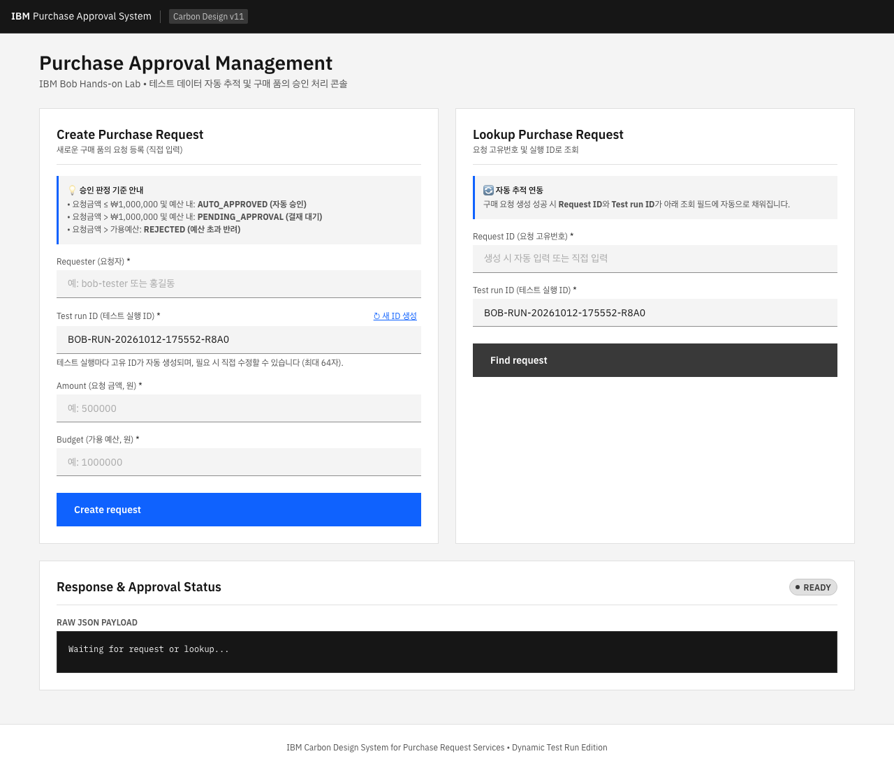
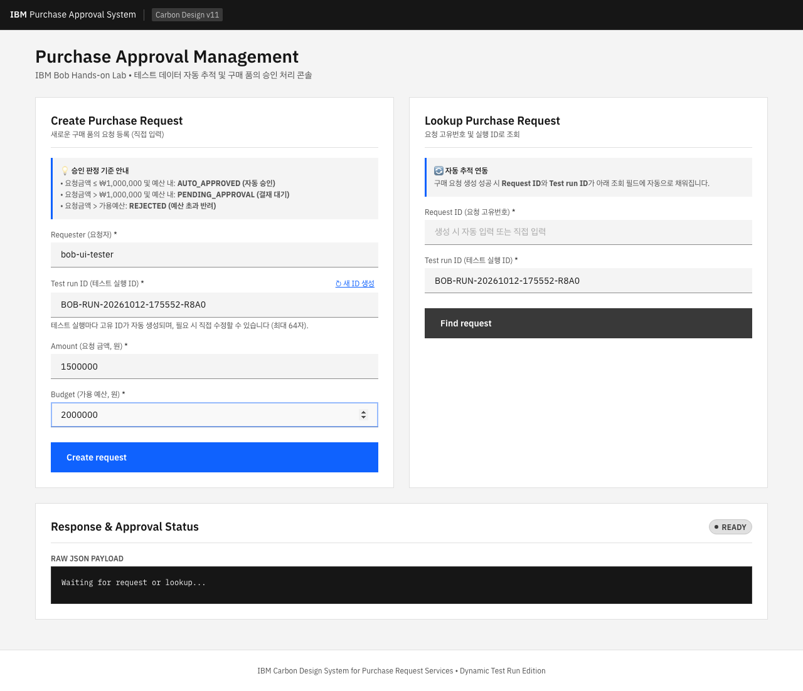
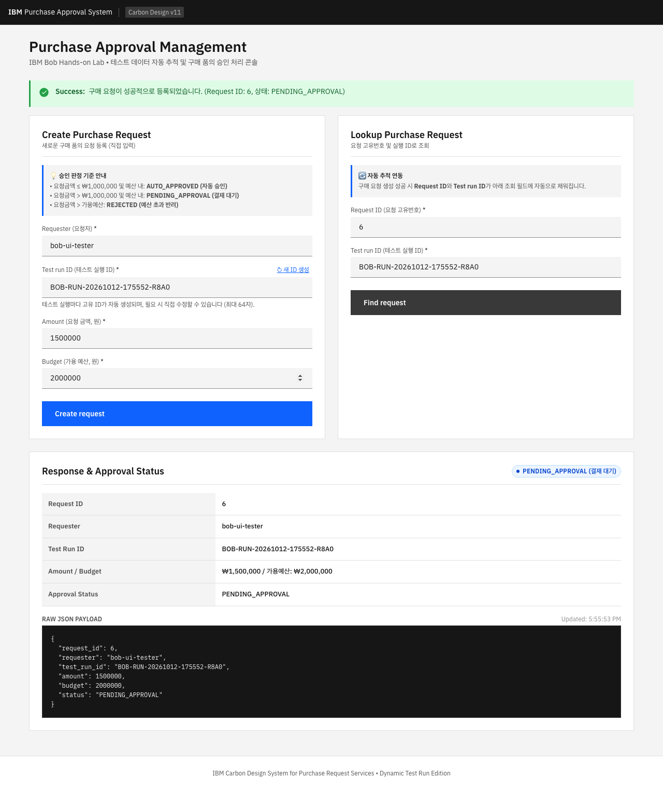

# 구매 승인 UI End-to-End 테스트 결과 보고서 (PENDING_APPROVAL)

## 1. 문서 정보

| 항목 | 내용 |
|---|---|
| **프로젝트** | Purchase Request System (구매 품의 관리 시스템) |
| **테스트 시나리오** | PENDING_APPROVAL 승인 대기 판정 및 조회 End-to-End 검증 |
| **테스트 대상 URL** | `http://localhost:8080/purchases.html` |
| **테스트 도구** | Playwright (Chromium Headless / 1280x900) |
| **테스트 일시** | 2026-10-12 17:55:17 (KST) |
| **디자인 시스템** | IBM Carbon Design System v11 (Thymeleaf UI) |
| **최종 결과** | **ALL PASSED (5/5 세부 검증 성공, 0 실패)** |

---

## 2. 테스트 목적 및 절차

### 2.1. 테스트 목적
요청 금액이 자동 승인 한도(₩1,000,000)를 초과하고 가용 예산 내에 있는 경우(`Amount: 1,500,000`, `Budget: 2,000,000`), 시스템이 `PENDING_APPROVAL (결재 대기)`로 올바르게 판정하는지 브라우저 E2E 테스트를 통해 검증합니다.

### 2.2. 테스트 절차
1. 브라우저에서 구매 승인 화면 접속 (`http://localhost:8080/purchases.html`)
2. `Requester`에 `bob-ui-tester` 입력
3. 현재 자동 생성된 `Test run ID` 기록 (`BOB-RUN-20261012-175552-R8A0`)
4. `Amount`에 `1500000` 입력
5. `Budget`에 `2000000` 입력
6. `Create request` 버튼 클릭
7. 생성 결과의 승인 상태가 `PENDING_APPROVAL`인지 검증
8. `Request ID` 및 `Test run ID`가 조회 입력 필드에 자동 반영되는지 확인
9. `Find request` 버튼 클릭
10. 조회 결과의 `Request ID`, `Test run ID`, `Amount`, `Budget`, `Status`를 생성 결과와 비교
11. 화면 스크린샷 및 테스트 결과 기록

---

## 3. 단계별 테스트 실행 및 검증 결과

| 단계 | 테스트 항목 | 기대 결과 | 실행 결과 | 상태 |
|:---:|---|---|---|:---:|
| **Step 1** | **구매 승인 화면 접속** | 페이지 정상 렌더링 및 Carbon UI 요소 로드 | `200 OK` 로드 완료 | **PASS** |
| **Step 2** | **테스트 데이터 입력** | `bob-ui-tester`, `1500000`, `2000000` 명시적 설정 | 입력값 정상 설정 및 Run ID 기록 | **PASS** |
| **Step 3** | **Create request 제출** | `POST /api/purchase-requests` 호출 및 `201 Created` 수신 | `request_id: 6` 발급 및 응답 수신 | **PASS** |
| **Step 4** | **승인 상태 PENDING_APPROVAL 검증** | 상태가 `PENDING_APPROVAL`로 판정되고 Blue Tag 배지 표시 | `PENDING_APPROVAL (결재 대기)` 배지 렌더링 확인 | **PASS** |
| **Step 5** | **조회 필드 자동 반영 검증** | 발급된 Request ID 및 Run ID가 조회 필드에 입력됨 | `#requestId: 6`, `#lookupRun` 동기화 확인 | **PASS** |
| **Step 6** | **Find request 조회 실행** | `GET /api/purchase-requests/6` 성공 및 상세 데이터 로드 | 조회 성공 및 알림 표시 | **PASS** |
| **Step 7** | **데이터 정합성 비교 검증** | 생성 데이터와 조회 데이터가 100% 일치 | 모든 필드 값 완전 일치 확인 | **PASS** |

---

## 4. 데이터 정합성 검증 테이블

| 검증 필드 | 생성 요청 (POST Payload) | 생성 응답 (POST Response) | 조회 응답 (GET Response) | 정합성 결과 |
|---|---|---|---|:---:|
| **Request ID** | *(서버 자동 채번)* | `6` | `6` | **일치 (PASS)** |
| **Requester** | `bob-ui-tester` | `bob-ui-tester` | `bob-ui-tester` | **일치 (PASS)** |
| **Test run ID** | `BOB-RUN-20261012-175552-R8A0` | `BOB-RUN-20261012-175552-R8A0` | `BOB-RUN-20261012-175552-R8A0` | **일치 (PASS)** |
| **Amount** | `1500000` | `1500000` (₩1,500,000) | `1500000` (₩1,500,000) | **일치 (PASS)** |
| **Budget** | `2000000` | `2000000` (₩2,000,000) | `2000000` (₩2,000,000) | **일치 (PASS)** |
| **Status** | *(비즈니스 룰 자동 평가)* | `PENDING_APPROVAL` | `PENDING_APPROVAL` | **일치 (PASS)** |

---

## 5. 단계별 실행 스크린샷

### 5.1. 초기 화면 접속 (`01_initial_screen.png`)
> 화면 접속 시 고유한 `Test run ID`가 자동 생성되어 있습니다.

---

### 5.2. 테스트 데이터 입력 (`02_form_filled.png`)
> `Requester: bob-ui-tester`, `Amount: 1500000`, `Budget: 2000000`이 입력된 상태입니다.

---

### 5.3. 구매 요청 생성 성공 및 PENDING_APPROVAL 배지 (`03_create_success.png`)
> `Create request` 실행 후 `PENDING_APPROVAL (결재 대기)` 상태 배지가 노출되고, 생성된 `Request ID: 6` 및 `Test run ID`가 조회 필드에 자동 채워집니다.

---

### 5.4. 구매 요청 조회 성공 및 정합성 일치 (`04_lookup_success.png`)
> `Find request` 실행 후 조회된 데이터와 생성 결과가 완벽히 일치함을 확인하였습니다.

---

## 6. 결론

1. **비즈니스 승인 규칙 검증 완료**: 요청 금액(₩1,500,000)이 자동 승인 한도(₩1,000,000)를 초과하고 예산(₩2,000,000) 범위 내인 경우 `PENDING_APPROVAL` 상태로 정상 처리됨을 확인하였습니다.
2. **UI 상태 시각화 검증 완료**: Carbon Design System의 Blue Tag 및 알림 메시지가 올바르게 표시되었습니다.
3. **데이터 정합성 및 자동화 연동 완벽**: `request_id`와 `test_run_id` 자동 연동 및 조회 결과 데이터 정합성이 100% 일치함을 확인하였습니다.
