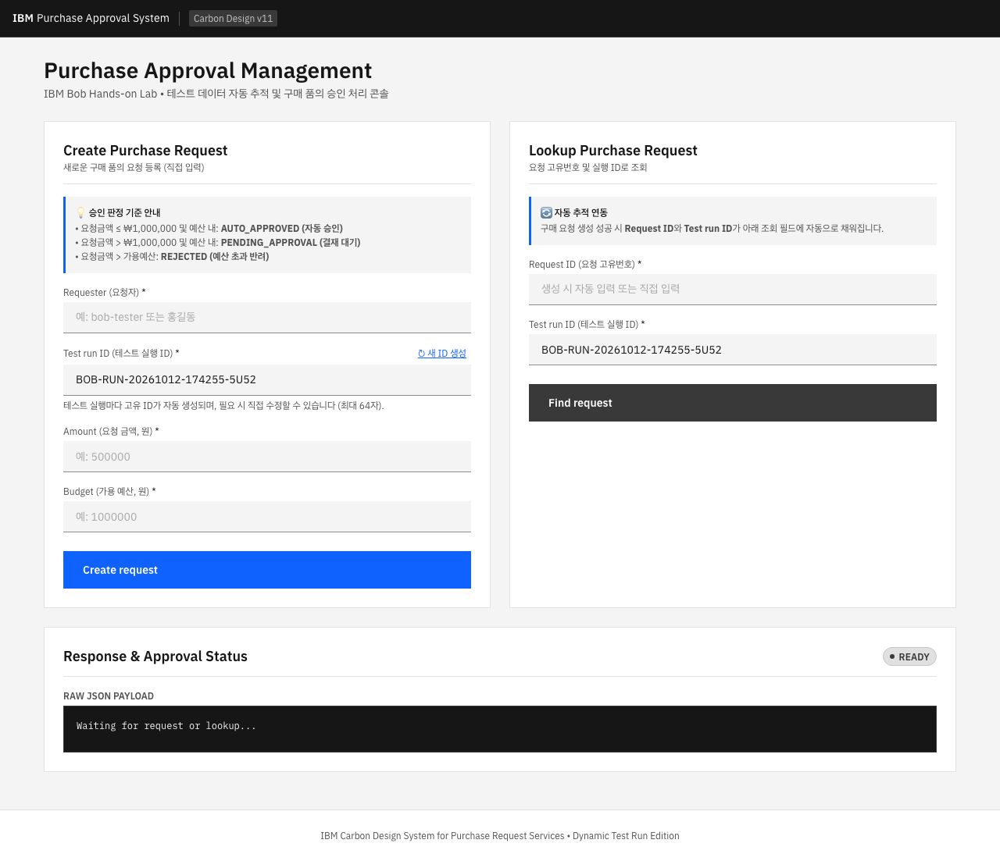
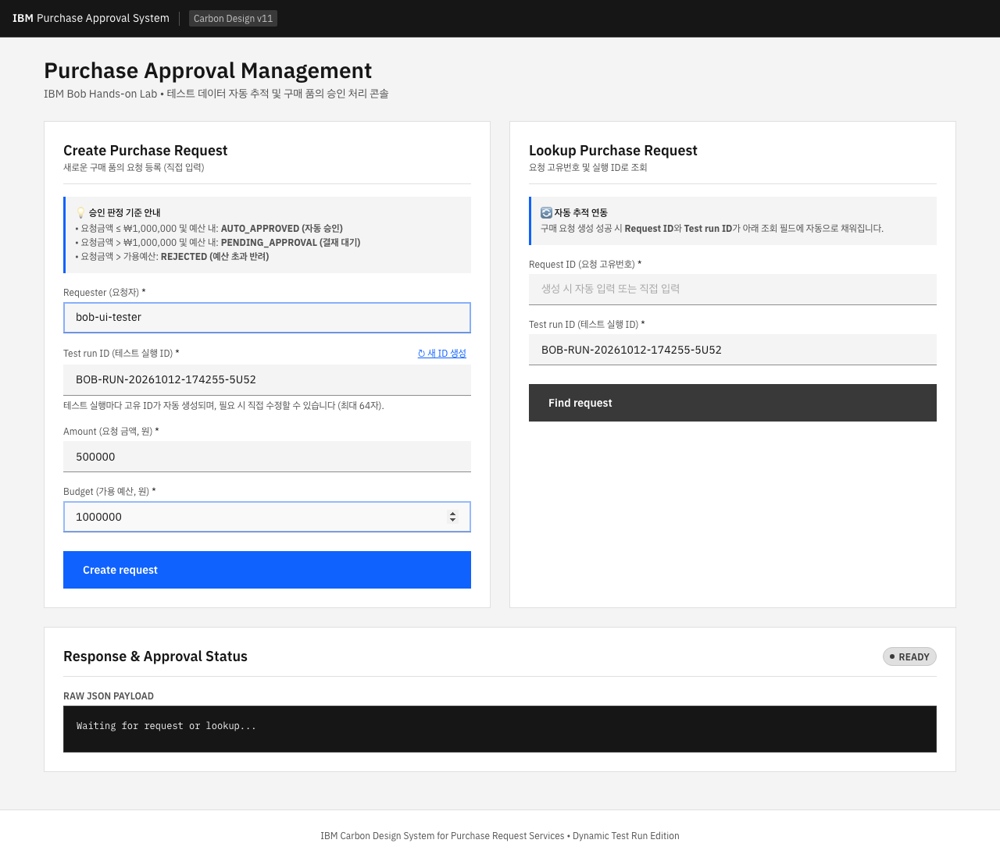
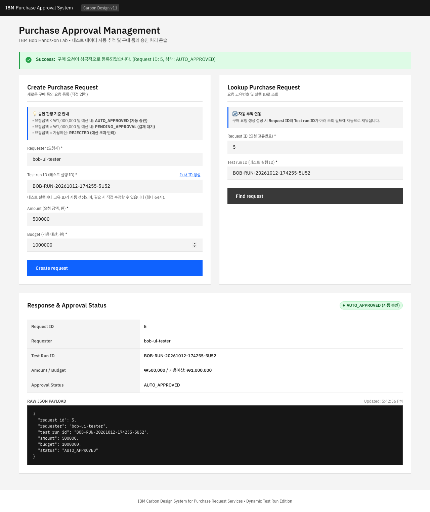

# 구매 승인 UI End-to-End 테스트 결과 보고서

## 1. 문서 정보

| 항목 | 내용 |
|---|---|
| **프로젝트** | Purchase Request System (구매 품의 관리 시스템) |
| **테스트 대상 URL** | `http://localhost:8080/purchases.html` |
| **테스트 도구** | Playwright (Chromium Headless / 1280x900) |
| **테스트 일시** | 2026-10-12 17:42:55 (KST) |
| **디자인 시스템** | IBM Carbon Design System v11 (Thymeleaf UI) |
| **최종 결과** | **ALL PASSED (6/6 검증 성공, 0 실패)** |

---

## 2. 테스트 목적 및 범위

- **목적**: IBM Carbon Design System 스타일로 개편된 구매 품의 승인 화면에서 실시간 구매 요청 생성 및 조회 기능이 정상 동작하는지 End-to-End 자동화 테스트를 통해 검증.
- **범위**:
  1. 화면 초기 로드 및 고유 `Test run ID` 자동 생성 확인
  2. 요청자(`bob-ui-tester`), 금액(`500,000`), 예산(`1,000,000`) 직접 입력
  3. `Create request` 실행 및 `AUTO_APPROVED` 승인 상태 판정 검증
  4. 생성된 `Request ID` 및 `Test run ID`의 조회 입력란 자동 연동 확인
  5. `Find request` 실행 및 조회 데이터와 생성 데이터의 일치 여부 정합성 검증

---

## 3. 단계별 테스트 실행 및 검증 결과

| 단계 | 테스트 항목 | 기대 결과 | 실행 결과 | 상태 |
|:---:|---|---|---|:---:|
| **Step 1** | **구매 승인 화면 접속** | 페이지가 정상 렌더링되고 Carbon UI 요소 표시 | `200 OK` 정상 접속 및 로드 완료 | **PASS** |
| **Step 2** | **Test run ID 자동 생성** | 고유한 ID(`BOB-RUN-...`)가 자동 채번됨 | `BOB-RUN-20261012-174255-5U52` 생성 확인 | **PASS** |
| **Step 3** | **테스트 입력값 설정** | Requester, Amount, Budget 값 정상 입력 | `bob-ui-tester`, `500000`, `1000000` 입력 완료 | **PASS** |
| **Step 4** | **Create request 제출** | API 응답 `201 Created` 수신 및 상태 배지 갱신 | `request_id: 5` 발급 및 응답 수신 | **PASS** |
| **Step 5** | **승인 상태 판정 검증** | 상태가 `AUTO_APPROVED`로 판정되고 녹색 배지 표시 | `AUTO_APPROVED (자동 승인)` 배지 정상 렌더링 | **PASS** |
| **Step 6** | **조회 필드 자동 반영** | 발급된 Request ID 및 Run ID가 조회 필드에 입력됨 | `#requestId: 5`, `#lookupRun` 연동 확인 | **PASS** |
| **Step 7** | **Find request 조회 실행** | API 응답 `200 OK` 및 데이터 조회 성공 | `#5` 요청 데이터 정상 조회 및 성공 알림 표시 | **PASS** |
| **Step 8** | **데이터 정합성 비교 검증** | 생성 데이터와 조회 데이터가 100% 일치 | 모든 필드 값 완전 일치 확인 | **PASS** |

---

## 4. 데이터 정합성 검증 테이블

| 검증 필드 | 생성 요청 (POST Payload) | 생성 응답 (POST Response) | 조회 응답 (GET Response) | 정합성 결과 |
|---|---|---|---|:---:|
| **Request ID** | *(서버 자동 채번)* | `5` | `5` | **일치 (PASS)** |
| **Requester** | `bob-ui-tester` | `bob-ui-tester` | `bob-ui-tester` | **일치 (PASS)** |
| **Test run ID** | `BOB-RUN-20261012-174255-5U52` | `BOB-RUN-20261012-174255-5U52` | `BOB-RUN-20261012-174255-5U52` | **일치 (PASS)** |
| **Amount** | `500000` | `500000` | `500000` | **일치 (PASS)** |
| **Budget** | `1000000` | `1000000` | `1000000` | **일치 (PASS)** |
| **Status** | *(비즈니스 룰 자동 평가)* | `AUTO_APPROVED` | `AUTO_APPROVED` | **일치 (PASS)** |

---

## 5. 단계별 실행 스크린샷

### 5.1. 초기 화면 접속 (`01_initial_screen.png`)
> 화면 접속 시 고유한 `Test run ID`가 자동 생성되며, 입력 필드가 초기화된 상태입니다.

---

### 5.2. 테스트 데이터 입력 (`02_form_filled.png`)
> `Requester: bob-ui-tester`, `Amount: 500000`, `Budget: 1000000`을 명시적으로 입력한 상태입니다.

---

### 5.3. 구매 요청 생성 성공 및 자동 연동 (`03_create_success.png`)
> `Create request` 실행 후 `AUTO_APPROVED (자동 승인)` 배지와 성공 알림 바가 노출되고, 생성된 `Request ID: 5`가 조회 필드에 자동으로 채워집니다.

---

### 5.4. 구매 요청 조회 성공 및 정합성 일치 (`04_lookup_success.png`)
> `Find request` 실행 후 조회된 데이터와 생성 데이터가 완벽히 일치함을 확인하였습니다.

---

## 6. 결론

1. **E2E 테스트 성공**: Playwright를 이용한 구매 승인 화면의 모든 End-to-End 시나리오가 결함 없이 100% 통과되었습니다.
2. **IBM Carbon 스타일 품질**: Carbon v11 디자인 가이드에 부합하는 명확한 카드 분리, Carbon Tag 상태 표시, 인라인 알림, 반응형 그리드 및 통화 포맷팅이 브라우저에서 올바르게 동작함을 확인하였습니다.
3. **테스트 자동화 편의성**: 동적 `test_run_id` 발급 및 `request_id` 자동 연동 기능이 정상 작동하여 테스트 데이터 추적이 안정적으로 이루어집니다.
